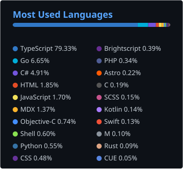

  <picture>
    <source media="(prefers-color-scheme: dark)" srcset="https://raw.githubusercontent.com/Narehood/Narehood/output/dist/pacman-contribution-graph-dark.svg">
    <source media="(prefers-color-scheme: light)" srcset="https://raw.githubusercontent.com/Narehood/Narehood/output/dist/pacman-contribution-graph.svg">
    
  </picture>

### GitHub Stats

<table>
  <tr>
    <td valign="top">
      
    </td>
    <td valign="top">
      
    </td>
  </tr>
</table>

### 👷 Check out what I'm currently working on
- [Narehood/xenadmin](https://github.com/Narehood/xenadmin) - A Modern XCP-ng Center (Alpha)
- [Narehood/Narehood-AI](https://github.com/Narehood/Narehood-AI) - Codex and AI skills
- [Narehood/VM-Setup](https://github.com/Narehood/VM-Setup) - General Linux/XCP-ng VM setup scripts
- [Narehood/Stitch-Revitalized-For-Roku](https://github.com/Narehood/Stitch-Revitalized-For-Roku) - A Twitch app for Roku
- [Narehood/Docker-Prep](https://github.com/Narehood/Docker-Prep) - Docker install and group setup helper

### 🌱 My latest projects
- [Narehood/xenadmin](https://github.com/Narehood/xenadmin) - A Modern XCP-ng Center (Alpha)
- [Narehood/Narehood-AI](https://github.com/Narehood/Narehood-AI) - Codex and AI skills
- [Narehood/VM-Setup](https://github.com/Narehood/VM-Setup) - General Linux/XCP-ng VM setup scripts
- [Narehood/Docker-Prep](https://github.com/Narehood/Docker-Prep) - Docker install and group setup helper
- [Narehood/dotfiles](https://github.com/Narehood/dotfiles) - Narehood Network Dot Files

### ⭐ Recent Stars

- [Narehood/Uptime-Canary](https://github.com/Narehood/Uptime-Canary)
- [Narehood/xenadmin](https://github.com/Narehood/xenadmin) - A Modern XCP-ng Center (Alpha)
- [expo/expo](https://github.com/expo/expo) - An open-source framework for making universal native apps with React. Expo runs on Android, iOS, and the web.
- [bilawalsidhu/gods-eye-view](https://github.com/bilawalsidhu/gods-eye-view) - God&#39;s Eye View: a spy satellite simulator in your browser, except the data is real. Live open source spatial intelligence on a photorealistic 3D globe. Official site: godseyeview.ai
- [t3dotgg/tstack](https://github.com/t3dotgg/tstack) - The agent skills I use every day. Works with Claude Code and Codex.
